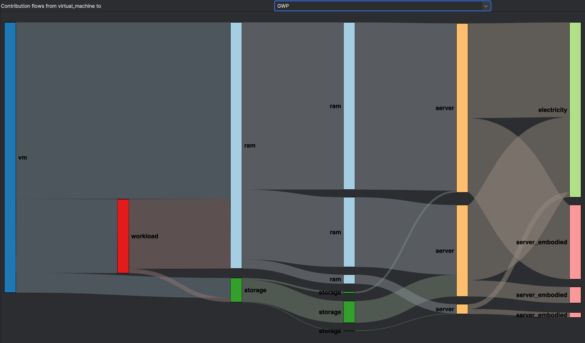

# Cloud Assess


This is the official repository of [Cloud Assess](https://cloudassess.org).

## What is Cloud Assess?

Cloud Assess is an open-source tool to automate the assessment of
the environmental impacts of cloud services.


## Table of Contents

1. [Getting Started](#getting-started)
2. [First Assessment](#first-assessment)
3. [How does it work?](#how-does-it-work)
    * [Trusted Library](#trusted-library)
    * [Adapt the models to your taste](#adapt-the-models-to-your-taste)
4. [License](#license)
5. [About us](#about-us)

## Getting Started

First, you need to clone this repository:

```bash
git checkout git@github.com:kleis-technology/cloud-assess.git
cd cloud-assess
```

All the commands in the sections below are to be run from the root of this repository.
We assume that you will run these commands in bash.
If you are using another shell, please adapt the commands accordingly.

### Docker-compose

You can run the server using `docker-compose`.

```bash
docker compose up -d
```

The server listens on [http://localhost:8080](http://localhost:8080).
The `docker-compose` also spins up a swagger ui instance, behind a proxy that serves the API on the same origin.
Visit [http://localhost/docs/](http://localhost/docs/) to explore the endpoints, DTOs and run example queries.
If the port 80 is already used on your machine, choose another one with `PROXY_PORT=8000 docker compose up -d`.

The OpenAPI specification of the API is served at `/openapi.json`.

### Local run

The server is the [LCA as Code](https://github.com/kleis-technology/lcaac) command-line tool `lcaac`, version 3.3.0 or later,
which requires Java 17.
Download `lcaac-cli-v<version>.tar.gz` from the [lcaac releases](https://github.com/kleis-technology/lcaac/releases),
extract it, and add its `bin` folder to your `PATH`.

Then, from the root of the git repository, run

```bash
cd trusted_library
lcaac serve -s lib
```

The server should start listening for requests on `localhost:8080`.
`lcaac api openapi` prints the OpenAPI specification of the API, and `lcaac serve --help` lists the options of the server.

## First Assessment

Each functional unit is associated with a specific API endpoint.

| Endpoint                   | Functional unit                     |
|----------------------------|-------------------------------------|
| `POST /compute_resources`  | Computing resources (FU5)           |
| `POST /virtual_machines`   | Virtual machines (FU6)              |
| `POST /storage_resources`  | Block storage (FU7)                 |
| `POST /pools`              | Pool of equipment, identified by id |

Every endpoint `POST /<name>` also has a batch version `POST /<name>/batch`, taking `{"requests": [...]}`.
Example requests are available in the folder `samples`.

For instance, say we want to assess the environmental impact of using a virtual machine.
The request `POST /virtual_machines` takes the following form:

```json
{
  "period": "1 hour",
  "total_vcpu": "100 vCPU",
  "total_ram": "100 GB",
  "total_storage": "100 TB",
  "virtual_machines": [
    {
      "id": "vm-01",
      "pool_id": "client_vm",
      "quantity": 1,
      "ram": "4 GB",
      "storage": "20 GB",
      "vcpu": "1 vCPU",
      "meta": {
        "region": "sofia",
        "env": "production"
      }
    }
  ]
}
```

In this request, we specify the usage of our virtual machine in terms
of the quantity of resources used (ram, storage and vCPU) during the period.
The fields `total_vcpu`, `total_ram` and `total_storage` describe the whole pool of virtual machines,
and are used to allocate the impacts of the pool to each virtual machine.
They are optional: by default, they are the sum over the virtual machines of the request.

Quantities are given as text, e.g., `"4 GB"`, as a number in the default unit, e.g., `4`,
or as an object, e.g., `{"amount": 4.0, "unit": "GB"}`.
The field `meta` is optional, and is returned as is in the response.

Running this request yields an impact assessment with the common LCA indicators,
in total and per life cycle step (manufacturing, transport, use and end of life).
Of course, in this example, we ran the assessment for a single virtual machine,
but nothing stops you from assessing as many virtual machines as you want:
the response contains one result per virtual machine.
<details>
<summary>
    Expand to see what the result looks like.
</summary>

```json
{
  "request": {
    "period": "1 hour",
    "total_vcpu": "100 vCPU",
    "total_ram": "100 GB",
    "total_storage": "100 TB"
  },
  "results": [
    {
      "row": {
        "id": "vm-01",
        "pool_id": "client_vm",
        "quantity": 1,
        "ram": "4 GB",
        "storage": "20 GB",
        "vcpu": "1 vCPU",
        "meta": {
          "region": "sofia",
          "env": "production"
        }
      },
      "outputs": {
        "total": {
          "ADPe": {"amount": 2.7244563676497693e-07, "unit": "kg Sb-Eq"},
          "ADPf": {"amount": 1.6398974883358208, "unit": "MJ, net calorific value"},
          "AP": {"amount": 0.000733627825160735, "unit": "mol H+-Eq"},
          "GWP": {"amount": 0.12786510826860784, "unit": "kg CO2-Eq"},
          "LU": {"amount": 0.04841428032704457, "unit": "u"},
          "ODP": {"amount": 0.0003777221061754429, "unit": "kg CFC-11-Eq"},
          "PM": {"amount": 4.047559395292748e-08, "unit": "disease incidence"},
          "POCP": {"amount": 4.5850729252495396e-05, "unit": "kg NMVOC-Eq"},
          "WU": {"amount": 0.004753679298309218, "unit": "m3 world eq. deprived"},
          "CTUe": {"amount": 1.6411637633585676, "unit": "CTUe"},
          "CTUh_c": {"amount": 3.962684005738905e-11, "unit": "CTUh"},
          "CTUh_nc": {"amount": 8.80188236098126e-10, "unit": "CTUh"},
          "Epf": {"amount": 6.946372920245792e-06, "unit": "kg P-Eq"},
          "Epm": {"amount": 0.00010194418365950182, "unit": "kg N-Eq"},
          "Ept": {"amount": 0.0010248040523684106, "unit": "mol N-Eq"},
          "IR": {"amount": 0.003788335706737753, "unit": "kBq U235-Eq"}
        },
        "manufacturing": {
          "ADPe": {"amount": 7.618192704286007e-08, "unit": "kg Sb-Eq"},
          "ADPf": {"amount": 0.5710586233679271, "unit": "MJ, net calorific value"},
          "AP": {"amount": 0.0002599212771267378, "unit": "mol H+-Eq"},
          "GWP": {"amount": 0.04341601532155369, "unit": "kg CO2-Eq"},
          "LU": {"amount": 0.0016178358007133964, "unit": "u"},
          "ODP": {"amount": 0.00015188221215002687, "unit": "kg CFC-11-Eq"},
          "PM": {"amount": 1.5946998276625128e-08, "unit": "disease incidence"},
          "POCP": {"amount": 1.3744958548587505e-06, "unit": "kg NMVOC-Eq"},
          "WU": {"amount": 0.0004234228790664816, "unit": "m3 world eq. deprived"},
          "CTUe": {"amount": 0.6412354867614493, "unit": "CTUe"},
          "CTUh_c": {"amount": 6.1931396572744474e-12, "unit": "CTUh"},
          "CTUh_nc": {"amount": 2.8178819297859717e-10, "unit": "CTUh"},
          "Epf": {"amount": 2.2861057491911063e-07, "unit": "kg P-Eq"},
          "Epm": {"amount": 3.093523679872225e-05, "unit": "kg N-Eq"},
          "Ept": {"amount": 0.0003254674487528003, "unit": "mol N-Eq"},
          "IR": {"amount": 0.0006360032420474949, "unit": "kBq U235-Eq"}
        },
        "transport": {
          "ADPe": {"amount": 2.544667382859162e-08, "unit": "kg Sb-Eq"},
          "ADPf": {"amount": 0.2762548132962621, "unit": "MJ, net calorific value"},
          "AP": {"amount": 0.0001249931198320436, "unit": "mol H+-Eq"},
          "GWP": {"amount": 0.020969728467600535, "unit": "kg CO2-Eq"},
          "LU": {"amount": 0.00036529039420655357, "unit": "u"},
          "ODP": {"amount": 7.395747719371993e-05, "unit": "kg CFC-11-Eq"},
          "PM": {"amount": 7.755141392532559e-09, "unit": "disease incidence"},
          "POCP": {"amount": 2.775575956504223e-08, "unit": "kg NMVOC-Eq"},
          "WU": {"amount": 4.744942299249148e-05, "unit": "m3 world eq. deprived"},
          "CTUe": {"amount": 0.30859455247947687, "unit": "CTUe"},
          "CTUh_c": {"amount": 2.238428932201913e-12, "unit": "CTUh"},
          "CTUh_nc": {"amount": 1.290983191221139e-10, "unit": "CTUh"},
          "Epf": {"amount": 5.79957976501266e-08, "unit": "kg P-Eq"},
          "Epm": {"amount": 1.4873205775961273e-05, "unit": "kg N-Eq"},
          "Ept": {"amount": 0.0001564158746386249, "unit": "mol N-Eq"},
          "IR": {"amount": 8.019371406080972e-09, "unit": "kBq U235-Eq"}
        },
        "use": {
          "ADPe": {"amount": 1.1839972799639955e-07, "unit": "kg Sb-Eq"},
          "ADPf": {"amount": 0.2250453482321173, "unit": "MJ, net calorific value"},
          "AP": {"amount": 9.184454544175973e-05, "unit": "mol H+-Eq"},
          "GWP": {"amount": 0.020406074878343786, "unit": "kg CO2-Eq"},
          "LU": {"amount": 0.04562201119518439, "unit": "u"},
          "ODP": {"amount": 2.236438321003629e-10, "unit": "kg CFC-11-Eq"},
          "PM": {"amount": 8.457972448032406e-10, "unit": "disease incidence"},
          "POCP": {"amount": 4.434556707265619e-05, "unit": "kg NMVOC-Eq"},
          "WU": {"amount": 0.004185388427892323, "unit": "m3 world eq. deprived"},
          "CTUe": {"amount": 0.05522417076875476, "unit": "CTUe"},
          "CTUh_c": {"amount": 2.643756164383562e-11, "unit": "CTUh"},
          "CTUh_nc": {"amount": 2.032872538043937e-10, "unit": "CTUh"},
          "Epf": {"amount": 6.531863505949198e-06, "unit": "kg P-Eq"},
          "Epm": {"amount": 2.552356023740542e-05, "unit": "kg N-Eq"},
          "Ept": {"amount": 0.00022157171711062988, "unit": "mol N-Eq"},
          "IR": {"amount": 0.0031503953756575067, "unit": "kBq U235-Eq"}
        },
        "end_of_life": {
          "ADPe": {"amount": 5.241730789712571e-08, "unit": "kg Sb-Eq"},
          "ADPf": {"amount": 0.5675387034395143, "unit": "MJ, net calorific value"},
          "AP": {"amount": 0.0002568688827601939, "unit": "mol H+-Eq"},
          "GWP": {"amount": 0.04307328960110983, "unit": "kg CO2-Eq"},
          "LU": {"amount": 0.0008091429369402286, "unit": "u"},
          "ODP": {"amount": 0.00015188219318786397, "unit": "kg CFC-11-Eq"},
          "PM": {"amount": 1.5927657038966555e-08, "unit": "disease incidence"},
          "POCP": {"amount": 1.0291056541541495e-07, "unit": "kg NMVOC-Eq"},
          "WU": {"amount": 9.741856835792173e-05, "unit": "m3 world eq. deprived"},
          "CTUe": {"amount": 0.6361095533488867, "unit": "CTUe"},
          "CTUh_c": {"amount": 4.757709824077069e-12, "unit": "CTUh"},
          "CTUh_nc": {"amount": 2.660144701930213e-10, "unit": "CTUh"},
          "Epf": {"amount": 1.2790304172735727e-07, "unit": "kg P-Eq"},
          "Epm": {"amount": 3.0612180847412875e-05, "unit": "kg N-Eq"},
          "Ept": {"amount": 0.0003213490118663555, "unit": "mol N-Eq"},
          "IR": {"amount": 1.9290696613450726e-06, "unit": "kBq U235-Eq"}
        }
      }
    }
  ]
}
```

</details>

## How does it work?

### Trusted Library

The ambition of Cloud Assess is to offer a library of *transparent*,
*PCR-compliant* and *executable* LCA models in the sector of digital services.
More precisely, this work builds on the
new PCR (to be published soon) for data center and cloud services.
The PCR defines 7 functional units, covering the hosting infrastructure (physical datacenter) up to
more abstract ones, e.g., virtual machines. 
Cloud Assess aims at covering all functional units, but also FU that are not explicitly covered by the PCR

| PCR No. | Functional Unit    | Model | API endpoint |
|---------|--------------------|-------|--------------|
| 1       | Datacenter         | n/a   | n/a          |
| 2       | Physical server    | ✅     | planned      |
| 3       | Storage            | ✅     | planned      |
| 4       | Network equipment  | ✅     | planned      |
| 5       | Computing resource | ✅     | ✅            |
| 6       | Virtual machine    | ✅     | ✅            |
| 7       | Block storage      | ✅     | ✅            |

These models are specified under the folder `trusted_library`.

### Adapt the models to your taste

#### Structure

The models are written in the [LCA as CODE](https://lca-as-code.com) language.
This is a domain-specific language designed for the need of lifecycle analysis.
The models under the folder `trusted_library/lib` are directly loaded in the server
to perform the assessments.
A [tutorial](https://lca-as-code.com/book) is available if you want to learn
more about the language itself.
The source repository is available [here](https://github.com/kleis-technology/lcaac).

The folder `trusted_library` is organized as follows.
* `lib` : this folder contains the models written in [LCA as CODE](https://lca-as-code.com).
* `inventory` : this folder contains inventory data (csv files)
* `lcaac.yaml` : the configuration of the library, including the definition of the API (see below)

Here is an illustration of this layering structure.



#### The API

The server is `lcaac serve`, and the API is declared in `trusted_library/lcaac.yaml`, under the key `api`.
Each operation names the process of the library to evaluate,
the request fields that set its parameters or replace the rows of a data source (e.g., `vm_inventory`),
and the outputs to return, selected in the trace of the evaluation (e.g., the impacts of the life cycle step `use`).
To expose a new functional unit, or other results of the existing ones, add or change an operation in this file:
the server checks the API against the models when it starts.

#### Configuring and deploying Cloud Assess

Check out the [wiki](https://github.com/kleis-technology/cloud-assess/wiki/Deploying-Cloud-Assess)
for a tutorial on how to configure and deploy Cloud Assess in a Kubernetes environment.

## License

The contents of this repository are licensed as follows:
- `trusted_library` folder: Licensed under the [Apache 2 license](LICENSE.Apache-2.0.txt)
- All other content: Dual-licensed under the GNU AGPL v3 or a commercial license (see [LICENSE](LICENSE.Dual.txt))

For commercial licensing inquiries, please contact us at `contact@kleis.ch`.

## About us

[Cloud Assess](https://cloudassess.org) is a joint-venture of [Resilio](https://resilio-solutions.com)
and [Kleis Technology](https://kleis.ch).

If you have any questions related to Cloud Assess, be it about the LCA methodology or ways to automate the assessments,
feel free to reach out to us at `contact@resilio.tech`.

<span>
 & 
</span>


